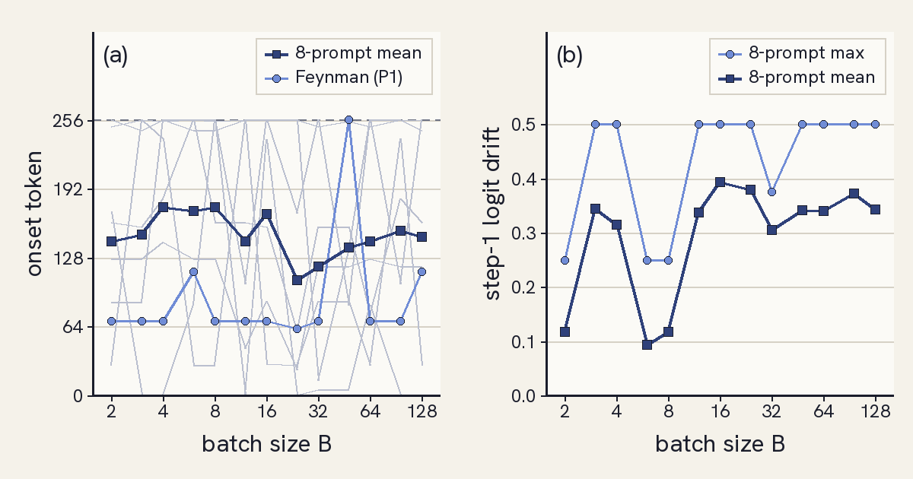

## Abstract

In greedy (`temperature = 0`) `bfloat16` decoding on an NVIDIA GPU, leaving batch size one triggers completion divergence right away, yet the token position where a completion splits is governed primarily by prompt-specific lexical near-ties rather than by how large the batch grows. This note measures the batch-size curve left unplotted by Horace He and Thinking Machines Lab in *Defeating Nondeterminism in LLM Inference* (*Thinking Machines Lab: Connectionism*, 2025) and follows up on the GPU claims we could not test first-hand in [our earlier CPU summation note](/posts/2026-07-16-temperature-zero-is-not-determinism.html).[@He2025Nondeterminism] Sweeping `Qwen/Qwen3-4B-Instruct-2507` across fourteen unpadded batch sizes ($B \in \{1, \dots, 128\}$) and eight factual prompts over 256 greedy tokens on an NVIDIA L4 GPU falsified our preregistered batch-graded onset hypothesis (`hypothesis_falsified`: [hypothesis_falsified]{.metric}).[@Yang2025Qwen3] All [n_diverging_prompts]{.metric} of [n_prompts_total]{.metric} prompts diverged from their $B = 1$ completions—producing [min_unique_completions_per_prompt]{.metric} to [max_unique_completions_per_prompt]{.metric} distinct completions across the fourteen batch sizes—and [b2_diverged_prompts]{.metric} of [n_prompts_total]{.metric} prompts already diverged at $B = 2$ (mean censored onset [b2_mean_censored_onset]{.metric}\ tokens at $B = 2$ versus [b128_mean_censored_onset]{.metric}\ tokens at $B = 128$). In a two-way variance decomposition of onset position, batch-size main effects account for [batch_share_of_total_variance_pct]{.metric}% of total variance against [prompt_share_of_total_variance_pct]{.metric}% for prompt identity (`Var_B / Var_p` = [batch_to_prompt_variance_ratio]{.metric}, below the preregistered 0.25 threshold) and [residual_share_of_total_variance_pct]{.metric}% for prompt-by-kernel interaction.

## Introduction

He and Thinking Machines Lab dismantled the folklore that thread-scheduling races make `temperature = 0` language-model endpoints nondeterministic: standard GPU forward passes are run-to-run deterministic at fixed tensor shapes, and output drift instead comes from the failure of **batch invariance** as server load changes how reductions in matrix multiplication, RMSNorm, and attention are tiled.[@He2025Nondeterminism] Their demonstration reported one striking operating point: sending `"Tell me about Richard Feynman"` 1,000 times to `Qwen3-235B-A22B-Instruct-2507` at `temperature = 0` returned 80 unique completions that agreed through token 102 and split at token 103.[@He2025Nondeterminism]

What that single operating point leaves unmeasured is the functional form of **divergence onset versus batch size** $B$. Two distinct pictures are consistent with batch non-invariance. If larger batches progressively perturb reductions or activate coarser tilings, divergence onset $t_{\mathrm{onset}}(B)$ should trend systematically with $B$—for instance, splitting earlier as a solo request ($B = 1$) is immersed in larger crowds ($B = 2 \to 128$). Conversely, if leaving $B = 1$ immediately switches CUDA kernels out of their split-K single-row path into a handful of discrete Tensor Core tile regimes, each perturbing `bfloat16` logits by a few units in the last place, then every batch size faces the same gatekeeper: `argmax` cannot flip until the prompt's own trajectory reaches a token step whose top two candidates are nearly tied.[@IEEE754_2019] Under that second picture, batch size acts as a discrete regime switch rather than a smooth dial, and prompt identity dominates *when* completions part ways.

With GPU access via Google Colab, we preregistered a direct test between those two pictures on an open-weights model from the same `Qwen3` `Instruct-2507` release family (`Qwen/Qwen3-4B-Instruct-2507`).[@Yang2025Qwen3] Before running any prompt, [`PREREGISTRATION.md`](/research/batch-size-divergence-onset/PREREGISTRATION.md) fixed the **batch-size-graded onset hypothesis**: across prompts that diverge from $B = 1$ within $T = 256$ greedy tokens over $B \in \{2, 3, 4, 6, 8, 12, 16, 24, 32, 48, 64, 96, 128\}$, (1) the median within-prompt onset range across $B \ge 2$ is at least 5.0 tokens, **and** (2) in a two-way additive decomposition across the $8 \times 13$ prompt-by-batch grid, batch-size main-effect variance is at least one quarter of prompt main-effect variance ($\mathrm{Var}_B / \mathrm{Var}_p \ge 0.25$). Failing either gate falsifies the batch-graded hypothesis in favor of flat or prompt-dominated onset.

## Computational Methods

**Model, inputs, and padding-free batch design.** We evaluated `Qwen/Qwen3-4B-Instruct-2507` (36 layers, 32 query heads, 8 key–value heads, head dimension 128, Apache-2.0 weights) in native `torch.bfloat16` using Hugging Face `transformers` (`eval()` mode, `torch.inference_mode()`, default `PyTorch` `sdpa` attention backend) with strict greedy decoding (`argmax` over vocabulary logits at each step $t = 1, \dots, 256$; no sampling, temperature scaling, or repetition penalty).[@Paszke2019; @Yang2025Qwen3] We did not use `vLLM`, `SGLang`, or `Qwen3-235B`; everything reported as experimental data here was generated directly from our explicit KV-cache loop (`run_colab_batch_divergence.py`).[@He2025Nondeterminism; @SGLang2025Deterministic] No living subjects were involved.

Eight prompts were frozen in [`inputs.json`](/research/batch-size-divergence-onset/inputs.json) and formatted with the tokenizer's standard chat template: He's anchor prompt `"Tell me about Richard Feynman"` (`P1`) plus five other scientific biographies (`Emmy Noether`, `Antoine Lavoisier`, `Alan Turing`, `Marie Curie`, `Ludwig Boltzmann`) and two physics expositions (`Maxwell's equations`, `Second law`). For each prompt $p$ (tokenized length $L_p \in [14, 18]$ tokens) and each batch size $B \in \{1, 2, 3, 4, 6, 8, 12, 16, 24, 32, 48, 64, 96, 128\}$, we passed a contiguous unpadded `(B, L_p)` tensor containing $B$ identical copies of prompt $p$ (`attention_mask = None`). Because sequence lengths and attention masks are identical across all rows and all $B$, every difference in slot `0` between $B = 1$ and $B > 1$ originates strictly from batch-size-dependent CUDA kernel selection. Code 1 shows the Colab execution commands.

**Code 1.** Commands used on Google Colab to verify `torch.mm` batch non-invariance and KV-cache equivalence, then sweep all eight prompts across fourteen batch sizes.

```sh
python3 research/batch-size-divergence-onset/run_colab_batch_divergence.py --smoke-test \
  --checkpoint-dir /content/drive/MyDrive/pvjohnston-colab/batch-size-divergence-onset

python3 research/batch-size-divergence-onset/run_colab_batch_divergence.py \
  --checkpoint-dir /content/drive/MyDrive/pvjohnston-colab/batch-size-divergence-onset
```

**Fidelity gates and mechanistic probes.** Three preregistered method-fidelity gates were checked before scoring the verdict: (1) back-to-back repeats at $B = 1$ and $B = 32$ on every prompt had to yield zero token mismatches and `0.0` bitwise step-1 logit difference; (2) reproducing He's `Code 2` (`torch.mm` on row `0` at $B = 1$ versus $B = 2048$, $D = 4096$) had to return non-zero drift, alongside exact token equivalence between our KV-cache loop and `model.generate(do_sample=False)` up to `<|im_end|>` on a non-registered test string; and (3) at least four of the eight prompts had to diverge from $B = 1$ within 256 tokens. For each `(p, B)`, we recorded `t_onset(p, B)` (censored at `257` when all 256 tokens matched $B = 1$), the continuous prefill logit drift $\max_v |\ell_{1,v}^{(B)} - \ell_{1,v}^{(1)}|$ at step 1, the number of distinct sequences among the $B$ homogeneous rows inside each call, and the $B = 1$ top-1 minus top-2 logit margin $\ell_{t,(1)}^{(1)} - \ell_{t,(2)}^{(1)}$ across all 256 steps. On `P1` (`Richard Feynman`), an additional control at $B = 8$ and $B = 32$ replaced the interior tokens of rows `1..B-1` with distinct token IDs of the exact same length $L_{P1}$ to test whether batchmates' token *identities* affect slot `0` at fixed tensor shape.

**Environment and reproducibility.** The canonical sweep ran on `2026-11-26` (`483ef01`, ~32.4 minutes wall time) on Google Colab `linux-x86_64` with an **NVIDIA L4** GPU (`22.6 GiB` VRAM, Ada `SM 8.9`, `58` SMs, driver `580.82.07`, CUDA `13.0`, cuDNN `92800`), CPython `3.13.16`, `PyTorch` `2.14.1+cu130` (`matmul_allow_tf32 = False`, `sdpa` enabled), `transformers` `5.24.1`, and `NumPy` `2.4.6` ([`environment.md`](/research/batch-size-divergence-onset/environment.md)). Local re-execution of `analyze_divergence.py --check`, `generate-metrics.mjs --check`, and `make-figure.py --check` on `osx-arm64` reproduced [`results.json`](/research/batch-size-divergence-onset/results.json), [`metrics.json`](/research/batch-size-divergence-onset/metrics.json), and Figure 1 byte-for-byte from the committed artifacts in [`PUBLIC_FILES.txt`](/research/batch-size-divergence-onset/PUBLIC_FILES.txt), earning **traceable**, **analysis-reproducible**, and **end-to-end reproducible** (on identical L4 / CUDA 13.0 hardware and package versions).

## Results

All method-fidelity checks passed (`method_fidelity_passed`: [method_fidelity_passed]{.metric}). Back-to-back repeats at $B = 1$ and $B = 32$ returned `0` token mismatches and `0.0` step-1 logit difference across all [n_prompts_total]{.metric} prompts. In the `torch.mm` check ($B = 1$ versus $B = 2048$, $D = 4096$), row `0` differed by [torch_mm_fp32_max_diff]{.metric} in `float32` and [torch_mm_bf16_max_diff]{.metric} in `bfloat16`, with `0.0` repeat difference. Inside every homogeneous batch across all prompts and batch sizes, all $B$ rows produced identical 256-token sequences (`all_intra_batch_rows_identical`: [all_intra_batch_rows_identical]{.metric}).

All [n_diverging_prompts]{.metric} of [n_prompts_total]{.metric} prompts diverged from their $B = 1$ completions within 256 tokens at five or more multi-request batch sizes (Table 1). Across the fourteen batch sizes, individual prompts produced between [min_unique_completions_per_prompt]{.metric} (`Emmy Noether`, `Alan Turing`) and [max_unique_completions_per_prompt]{.metric} (`Antoine Lavoisier`, a distinct 256-token completion at every tested batch size) unique completions, with a median of [median_unique_completions_per_prompt]{.metric}. On He's benchmark prompt `"Tell me about Richard Feynman"` (`P1`), [p1_feynman_diverging_batches]{.metric} of the 13 multi-request batch sizes diverged, yielding [p1_feynman_unique_completions]{.metric} distinct completions: [p1_feynman_modal_onset_batch_count]{.metric} batch sizes split at token [p1_feynman_modal_onset_token]{.metric} (`"### Key Contributions"` at $B = 1$ versus `"### Key Facts"`), $B = 24$ split at token [p1_feynman_min_onset]{.metric} (`"figure in"` versus `"figure both"`), $B = 6$ and $B = 128$ split at token [p1_feynman_max_uncensored_onset]{.metric} (`"calculations in"` versus `"calculations involving"`), and $B = 48$ matched $B = 1$ across all 256 tokens.

**Table 1.** Per-prompt divergence statistics across the 13 multi-request batch sizes ($B \in \{2, \dots, 128\}$) relative to $B = 1$ over 256 greedy tokens.

| Prompt | Diverging batches (of 13) | Unique completions (of 14) | Earliest onset token | Latest uncensored onset | Spearman $\rho(B, t_{\mathrm{onset}})$ | Earliest token flip ($B = 1$ $\to$ $B > 1$) |
| --- | ---: | ---: | ---: | ---: | ---: | --- |
| `P1` Richard Feynman | [p1_feynman_diverging_batches]{.metric} | [p1_feynman_unique_completions]{.metric} | [p1_feynman_min_onset]{.metric} | [p1_feynman_max_uncensored_onset]{.metric} | [p1_feynman_spearman_rho]{.metric} | `" in"` $\to$ `" both"` |
| `P2` Emmy Noether | [p2_noether_diverging_batches]{.metric} | [p2_noether_unique_completions]{.metric} | [p2_noether_min_onset]{.metric} | [p2_noether_max_uncensored_onset]{.metric} | [p2_noether_spearman_rho]{.metric} | `" on"` $\to$ `" in"` |
| `P3` Antoine Lavoisier | [p3_lavoisier_diverging_batches]{.metric} | [p3_lavoisier_unique_completions]{.metric} | [p3_lavoisier_min_onset]{.metric} | [p3_lavoisier_max_uncensored_onset]{.metric} | [p3_lavoisier_spearman_rho]{.metric} | `" is"` $\to$ `" physicist"` |
| `P4` Alan Turing | [p4_turing_diverging_batches]{.metric} | [p4_turing_unique_completions]{.metric} | [p4_turing_min_onset]{.metric} | [p4_turing_max_uncensored_onset]{.metric} | [p4_turing_spearman_rho]{.metric} | `"."` $\to$ `".\n\n"` |
| `P5` Marie Curie | [p5_curie_diverging_batches]{.metric} | [p5_curie_unique_completions]{.metric} | [p5_curie_min_onset]{.metric} | [p5_curie_max_uncensored_onset]{.metric} | [p5_curie_spearman_rho]{.metric} | `"Certainly"` $\to$ `"Mar"` |
| `P6` Ludwig Boltzmann | [p6_boltzmann_diverging_batches]{.metric} | [p6_boltzmann_unique_completions]{.metric} | [p6_boltzmann_min_onset]{.metric} | [p6_boltzmann_max_uncensored_onset]{.metric} | [p6_boltzmann_spearman_rho]{.metric} | `" of"` $\to$ `" who"` |
| `P7` Maxwell's equations | [p7_maxwell_diverging_batches]{.metric} | [p7_maxwell_unique_completions]{.metric} | [p7_maxwell_min_onset]{.metric} | [p7_maxwell_max_uncensored_onset]{.metric} | [p7_maxwell_spearman_rho]{.metric} | `" in"` $\to$ `" that"` |
| `P8` Second law | [p8_thermodynamics_diverging_batches]{.metric} | [p8_thermodynamics_unique_completions]{.metric} | [p8_thermodynamics_min_onset]{.metric} | [p8_thermodynamics_max_uncensored_onset]{.metric} | [p8_thermodynamics_spearman_rho]{.metric} | `" real"` $\to$ `" actual"` |

Across prompts, the median within-prompt censored onset range over $B \ge 2$ is [median_within_prompt_censored_range_tokens]{.metric}\ tokens ([median_within_prompt_uncensored_range_tokens]{.metric}\ tokens uncensored), passing the first gate ($\ge 5.0$ tokens). Within-prompt Spearman rank correlations between $B$ and censored onset span [spearman_rho_min]{.metric} to [spearman_rho_max]{.metric}, with median [spearman_rho_median]{.metric}. In the two-way additive decomposition across the $8 \times 13$ grid (grand mean [grand_mean_censored_onset_tokens]{.metric}\ tokens), prompt main effects account for [prompt_share_of_total_variance_pct]{.metric}% of total variance, batch-size main effects account for [batch_share_of_total_variance_pct]{.metric}%, and the prompt-by-batch residual accounts for [residual_share_of_total_variance_pct]{.metric}%, giving $\mathrm{Var}_B / \mathrm{Var}_p =$ [batch_to_prompt_variance_ratio]{.metric} against the preregistered 0.25 floor (`hypothesis_supported`: [hypothesis_supported]{.metric}; `hypothesis_falsified`: [hypothesis_falsified]{.metric}).

<figure>
  
</figure>

**Figure 1.** Batch-size sweep from $B = 2$ to $B = 128$ on `Qwen/Qwen3-4B-Instruct-2507` in `bfloat16`: (a) censored token-divergence onset relative to $B = 1$ (dashed line at 257 marks 256 matching tokens; gray lines show individual prompts, circles show `P1` Richard Feynman, and squares show the eight-prompt mean) and (b) prefill step-1 maximum absolute logit difference relative to $B = 1$ (eight-prompt maximum and eight-prompt mean).

Table 2 reports the aggregate curve across batch sizes $B = 2$ to $B = 128$ plotted in Figure 1. Step-1 maximum logit drift relative to $B = 1$ reaches [b2_max_step1_logit_diff]{.metric}\ logit units at $B = 2$ and [b3_max_step1_logit_diff]{.metric}\ logit units at $B = 3$, drops to a mean of [b6_mean_step1_logit_diff]{.metric} and [b8_mean_step1_logit_diff]{.metric} at $B = 6$ and $B = 8$, and stays between [b32_mean_step1_logit_diff]{.metric} and [b16_mean_step1_logit_diff]{.metric} mean ([b32_max_step1_logit_diff]{.metric} to [b128_max_step1_logit_diff]{.metric} maximum) across $B = 12$ to $B = 128$.

**Table 2.** Aggregate divergence counts, mean censored onset positions, and prefill step-1 logit drift across the 13 multi-request batch sizes ($N = 8$ prompts).

| Batch size $B$ | Diverging prompts (of 8) | Mean censored onset (tokens) | Mean step-1 $|\Delta\text{logit}|$ | Max step-1 $|\Delta\text{logit}|$ |
| ---: | ---: | ---: | ---: | ---: |
| 2 | [b2_diverged_prompts]{.metric} | [b2_mean_censored_onset]{.metric} | [b2_mean_step1_logit_diff]{.metric} | [b2_max_step1_logit_diff]{.metric} |
| 3 | [b3_diverged_prompts]{.metric} | [b3_mean_censored_onset]{.metric} | [b3_mean_step1_logit_diff]{.metric} | [b3_max_step1_logit_diff]{.metric} |
| 4 | [b4_diverged_prompts]{.metric} | [b4_mean_censored_onset]{.metric} | [b4_mean_step1_logit_diff]{.metric} | [b4_max_step1_logit_diff]{.metric} |
| 6 | [b6_diverged_prompts]{.metric} | [b6_mean_censored_onset]{.metric} | [b6_mean_step1_logit_diff]{.metric} | [b6_max_step1_logit_diff]{.metric} |
| 8 | [b8_diverged_prompts]{.metric} | [b8_mean_censored_onset]{.metric} | [b8_mean_step1_logit_diff]{.metric} | [b8_max_step1_logit_diff]{.metric} |
| 12 | [b12_diverged_prompts]{.metric} | [b12_mean_censored_onset]{.metric} | [b12_mean_step1_logit_diff]{.metric} | [b12_max_step1_logit_diff]{.metric} |
| 16 | [b16_diverged_prompts]{.metric} | [b16_mean_censored_onset]{.metric} | [b16_mean_step1_logit_diff]{.metric} | [b16_max_step1_logit_diff]{.metric} |
| 24 | [b24_diverged_prompts]{.metric} | [b24_mean_censored_onset]{.metric} | [b24_mean_step1_logit_diff]{.metric} | [b24_max_step1_logit_diff]{.metric} |
| 32 | [b32_diverged_prompts]{.metric} | [b32_mean_censored_onset]{.metric} | [b32_mean_step1_logit_diff]{.metric} | [b32_max_step1_logit_diff]{.metric} |
| 48 | [b48_diverged_prompts]{.metric} | [b48_mean_censored_onset]{.metric} | [b48_mean_step1_logit_diff]{.metric} | [b48_max_step1_logit_diff]{.metric} |
| 64 | [b64_diverged_prompts]{.metric} | [b64_mean_censored_onset]{.metric} | [b64_mean_step1_logit_diff]{.metric} | [b64_max_step1_logit_diff]{.metric} |
| 96 | [b96_diverged_prompts]{.metric} | [b96_mean_censored_onset]{.metric} | [b96_mean_step1_logit_diff]{.metric} | [b96_max_step1_logit_diff]{.metric} |
| 128 | [b128_diverged_prompts]{.metric} | [b128_mean_censored_onset]{.metric} | [b128_mean_step1_logit_diff]{.metric} | [b128_max_step1_logit_diff]{.metric} |

Across all observed divergence onset positions in the $8 \times 13$ sweep, the $B = 1$ top-1 minus top-2 logit margin had a median of [median_b1_margin_at_flip_steps]{.metric}\ logit units and a maximum of [max_b1_margin_at_flip_steps]{.metric}\ logit units, compared with a median of [median_b1_margin_at_nonflip_steps]{.metric}\ logit units across non-flipping steps. In the neighbor-content control on `P1` (`Richard Feynman`) at $B = 8$ and $B = 32$, replacing rows `1..B-1` with distinct token sequences of identical length produced [feynman_neighbor_b8_mismatches]{.metric} and [feynman_neighbor_b32_mismatches]{.metric} token mismatches in slot `0` relative to the homogeneous batch of the same $B$, with maximum step-1 logit difference [feynman_neighbor_max_logit_diff]{.metric}.

## Discussion

The preregistered batch-graded onset hypothesis was **falsified**. While divergence onset is far from identical across batch sizes within a single prompt—jumping across a median censored range of [median_within_prompt_censored_range_tokens]{.metric}\ tokens as $B$ moves across discrete kernel regimes—there is no systematic trend toward earlier divergence as batch size increases (Figure 1a). Going from $B = 1$ to $B = 2$ already causes [b2_diverged_prompts]{.metric} of [n_prompts_total]{.metric} prompts to diverge at a mean censored onset of [b2_mean_censored_onset]{.metric}\ tokens, virtually indistinguishable from $B = 128$ ([b128_diverged_prompts]{.metric} of [n_prompts_total]{.metric} prompts, mean [b128_mean_censored_onset]{.metric}\ tokens). Consequently, batch-size main effects explain just [batch_share_of_total_variance_pct]{.metric}% of onset variance against [prompt_share_of_total_variance_pct]{.metric}% for prompt identity ($\mathrm{Var}_B / \mathrm{Var}_p =$ [batch_to_prompt_variance_ratio]{.metric}, failing our 0.25 gate).

Figure 1b and the margin statistics show why the curve has this shape. Leaving $B = 1$ immediately alters kernel reduction trees enough to move `bfloat16` prefill logits by up to [b3_max_step1_logit_diff]{.metric}\ logit units (`2–4` `bfloat16` ulps at logit magnitude $16\text{–}32$, where one ulp is $2^{-3} = 0.125$). Notice the non-monotonic dip at $B = 6$ and $B = 8$ (mean step-1 drift [b6_mean_step1_logit_diff]{.metric}–[b8_mean_step1_logit_diff]{.metric}) before the curve settles near [b32_mean_step1_logit_diff]{.metric}–[b16_mean_step1_logit_diff]{.metric} across $B \ge 12$: CUDA libraries do not accumulate error proportionally to $B$, they switch among discrete tile kernels (`split-K` GEMV at $B = 1$ versus small-tile and Tensor Core MMA shapes at $B \ge 2$), occasionally even landing back on the exact $B = 1$ completion across all 256 tokens (as `P1` Richard Feynman does at $B = 48$ and `P2` Emmy Noether does at seven different even batch sizes!).[@He2025Nondeterminism]

Because the logit perturbation already saturates near [b3_max_step1_logit_diff]{.metric}\ logit units by $B = 3$, `argmax` acts as a threshold detector for near-ties along each prompt's text. Ordinary decoding steps carry a median top-1 lead of [median_b1_margin_at_nonflip_steps]{.metric}\ logit units—more than ten times wider than the largest batch perturbation—so they never budge. Every single observed divergence across all 26,624 decoded tokens occurred at a step whose $B = 1$ margin was at most [max_b1_margin_at_flip_steps]{.metric}\ logit units, with a median of [median_b1_margin_at_flip_steps]{.metric}\ (literally one `bfloat16` ulp, including exact `0.0` `bfloat16` ties). When `Marie Curie` opens with a [p5_curie_min_onset]{.metric}-st token tie between `"Certainly"` and `"Marie"`, divergence starts at token 1; when `Richard Feynman` hits a formatting near-tie between `"### Key Contributions"` and `"### Key Facts"` at token [p1_feynman_modal_onset_token]{.metric}, nine different batch sizes split right there; when `Alan Turing` encounters no near-tie until a period-versus-paragraph-break choice at token [p4_turing_min_onset]{.metric}, every batch size stays locked together for 249 tokens.

The two controls sharpen a common phrasing from [our earlier note's title](/posts/2026-07-16-temperature-zero-is-not-determinism.html) (*"your logits depend on who else is in the batch"*). In standard unpadded `PyTorch` `SDPA` + `cuBLAS` inference, replacing rows `1..B-1` with completely different tokens of the same length changed slot `0`'s logits by [feynman_neighbor_max_logit_diff]{.metric} (`0` bits), and all $B$ identical rows inside every homogeneous batch agreed (`all_intra_batch_rows_identical`: [all_intra_batch_rows_identical]{.metric}). Your batchmates' *words* never enter your dot products; what alters your reduction tree is strictly the **shape** of the batch (how many rows or flattened prefill tokens share the kernel launch). In a continuous-batching engine like `vLLM` or `SGLang` that concatenates variable-length requests into one ragged `(total_tokens, hidden)` matrix, other users' *prompt lengths* determine `total_tokens`, still acting purely through tensor dimensions rather than semantic interference.[@He2025Nondeterminism; @SGLang2025Deterministic]

These boundaries frame what this experiment does and does not cover. Our padding-free static batches isolate `M = B` decode and `M = B × L` prefill shape transitions cleanly on one `Qwen3-4B-Instruct-2507` checkpoint and one NVIDIA L4 (`SM 8.9`, CUDA `13.0`) stack; ragged chunked-prefill splits in `vLLM`, PagedAttention KV-block tables, Mixture-of-Experts router top-$k$ ties (present in `Qwen3-235B-A22B` where a `bfloat16` perturbation can flip expert selection before `argmax`!), and multi-GPU `all_reduce` trees add further shape-dependent reductions that could increase unique-completion counts beyond the [min_unique_completions_per_prompt]{.metric}–[max_unique_completions_per_prompt]{.metric} regimes observed across our 14 static shapes.[@He2025Nondeterminism; @BatchInvariantOps] Readers running ragged continuous-batching sweeps or MoE checkpoints who observe a monotonic $B$-dependence are warmly invited to send a correction.

## Conclusion

Plotting the batch-size curve confirms batch non-invariance first-hand while separating **trigger** from **timing**: stepping from $B = 1$ to $B = 2$ is already enough to flip greedy `bfloat16` completions on [b2_diverged_prompts]{.metric} of [n_prompts_total]{.metric} prompts, and further increases up to $B = 128$ hop non-monotonically among discrete CUDA tile equivalence classes rather than accelerating divergence. When a completion splits is set instead by where the prompt's own prose narrows the top-two logit margin to $\le$ [max_b1_margin_at_flip_steps]{.metric}\ logit units. Consequently, even a lightly loaded server batching two concurrent requests suffers the full reproducibility hazard that batch-invariant kernels are built to eliminate.[@BatchInvariantOps]

The direct architectural follow-up on the same `Qwen3` family is **Mixture-of-Experts routing amplification**: comparing dense `Qwen3-4B` against a sparse MoE checkpoint (such as `Qwen3-30B-A3B`) on the identical `8 × 14` grid to test whether top-$k$ expert-gate flips multiply internal logit drift above the [b3_max_step1_logit_diff]{.metric}-unit dense ceiling and break higher-margin tokens earlier.

## References
