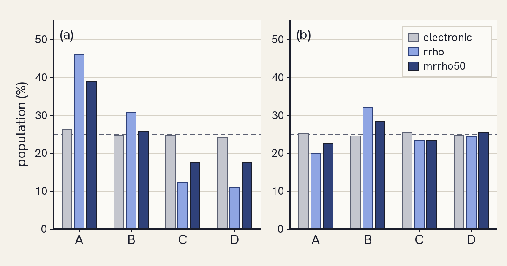

## Abstract

When electronic energies and 298.15 K harmonic free-energy corrections are computed together on one hybrid-DFT plus implicit-water surface (`B3LYPG-D3(BJ)/def2-TZVP` with `IEF-PCM` water), the four aqueous sulfamethoxazole minima remain nearly equally populated rather than concentrating onto a single dominant conformer. This note is an independent single-surface follow-up to Hannah Blackmon and Kristina D. Closser's *Determination of Ground-State Structure and Electronic Excitations of Sulfamethoxazole Using Density Functional Theory* (*Comput. Theor. Chem.* **1264**, 2026, 115931) and tests a conclusion of [our earlier composite thermochemistry note](/posts/2026-08-03-does-the-near-uniform-smx-ensemble-survive-thermal-correction.html).[@Blackmon2026] In that earlier note, adding a `GFN2-xTB/ALPB(water)` harmonic correction to Blackmon and Closser's electronic energies moved conformer A from [source_population_a]{.metric} to almost half of the ensemble, leaving open whether the concentration came from thermal vibrations or from mixing two potential energy surfaces.[@Bannwarth2019; @Ehlert2021] Under a protocol frozen before calculation, re-optimizing conformers A–D and evaluating analytical nuclear Hessians on the single `B3LYPG-D3(BJ)/def2-TZVP + IEF-PCM(water)` surface falsified our preregistered concentration hypothesis in both rotor-treatment arms: the maximum population shift from the single-surface electronic baseline is [rrho_max_population_shift_pp]{.metric}\ percentage points under pure rigid-rotor–harmonic-oscillator (`rrho`) thermochemistry and [mrrho50_max_population_shift_pp]{.metric}\ percentage points under Grimme's 50 cm^−1^ modified-RRHO (`mrrho50`) interpolation, with effective conformer counts of [rrho_effective_conformer_count]{.metric} and [mrrho50_effective_conformer_count]{.metric}.[@Grimme2012] Weighting all four aqueous conformers nearly equally is robust to harmonic thermal correction at this DFT level; the earlier concentration onto conformer A came from the semiempirical Hessian.

## Introduction

Blackmon and Closser optimize sulfamethoxazole (SMX) in implicit water to four distinct ground-state minima, A–D, spanning 0.202 kJ/mol in electronic energy, and report 298 K Boltzmann populations of [source_population_a]{.metric}, [source_population_b]{.metric}, [source_population_c]{.metric}, and [source_population_d]{.metric} from electronic energies without zero-point or thermal corrections.[@Blackmon2026] Their paper notes that harmonic frequencies were computed to verify each minimum, though neither those frequencies nor thermally corrected free energies appear in the article or its supplement.

In [the preceding note in this series](/posts/2026-08-03-does-the-near-uniform-smx-ensemble-survive-thermal-correction.html), we probed that unprinted step with a standard low-cost composite construction, adding 298.15 K `GFN2-xTB/ALPB(water)` free-energy corrections to Blackmon and Closser's published electronic energies.[@Bannwarth2019; @Ehlert2021] That composite correction broke the near-uniform quartet in both rotor-cutoff arms, lifting conformer A near 40–46% and cutting C and D roughly in half. As that note's Discussion and Conclusion emphasized, however, a two-level sum mixes electronic curvature from one method with torsional curvature from another. Sulfamethoxazole's conformers differ in sulfonamide and aniline torsion angles whose lowest vibrational modes sit near 10–50 cm^−1^, where small differences in semiempirical versus hybrid-DFT curvature can shift $T\Delta S$ by several kJ/mol.[@Grimme2012]

Evaluating both electronic energies and analytical harmonic Hessians on one solvated hybrid-DFT surface was slower than an afternoon laptop job, so we moved the quantum-chemistry stage to an NVIDIA GPU via `GPU4PySCF` while keeping the statistical thermodynamics local and deterministic.[@Sun2020PySCF; @Li2025GPU4PySCF] To test our own earlier reading directly, we preregistered the **single-surface concentration hypothesis** on the exact logical complement of the first note's near-uniformity region: **relative to the single surface's own 298.15 K electronic-energy Boltzmann baseline, in both the `rrho` and `mrrho50` arms, either at least one conformer's population shifts by 10.0 percentage points or more, or the effective conformer count $N_{\mathrm{eff}} = 1/\sum_i p_i^2$ falls below 3.5.** The falsifier, fixed in [`PREREGISTRATION.md`](/research/smx-single-surface-thermochemistry/PREREGISTRATION.md) before any SMX DFT job ran, is that both arms return inside the near-uniform region ($\max_i |\Delta p_i| < 10.0$ percentage points and $N_{\mathrm{eff}} \ge 3.5$). Disagreement between the two arms or failure of any convergence, gradient, imaginary-mode, or geometry-identity gate yields an inconclusive verdict.

## Computational Methods

**Source inputs and claim boundary.** Starting Cartesian coordinates and reference electronic energies for conformers A–D were taken unchanged from the canonicalized 28-atom input manifest of the first note, transcribed from Blackmon and Closser's supplementary material.[@Blackmon2026] We did not use Q-Chem or attempt to match Q-Chem's internal cavity tessellation; every electronic energy, geometry optimization, and nuclear Hessian reported as primary data here was computed independently on a single `PySCF` / `GPU4PySCF` potential energy surface.[@Sun2020PySCF; @Li2025GPU4PySCF] No living subjects were involved.

**Electronic structure, optimization, and analytical Hessians.** All protocol parameters were frozen in commit `f02a885` prior to the canonical run. Each neutral closed-shell conformer was modeled with conventional four-center integrals (no density fitting) using the Q-Chem/Gaussian **B3LYP** functional definition (`xc = 'b3lypg'`), Becke–Johnson damped D3 dispersion (`d3bj`), and Ahlrichs' `def2-TZVP` basis set (`599` spherical basis functions, Lebedev XC `grids.level = 4`).[@Becke1993Exchange; @Grimme2011; @Weigend2005Balanced] Aqueous solvation used the **integral equation formalism polarizable continuum model** (`IEF-PCM`, $\varepsilon = 78.3553$, Lebedev surface order `29`).[@Cances1997IEFPCM] Self-consistent field convergence thresholds were $10^{-10}\ E_\mathrm{h}$ on energy and $10^{-7}\ E_\mathrm{h}/a_0$ on orbital gradients. Each conformer was tightly re-optimized from its published geometry using `geomeTRIC` (`|ΔE| < 10^-6` $E_\mathrm{h}$, RMS gradient `< 10^-4` $E_\mathrm{h}/a_0$, maximum gradient `< 3×10^-4` $E_\mathrm{h}/a_0$, RMS displacement `< 4×10^-4` $a_0$, maximum displacement `< 1.2×10^-3` $a_0$), followed by a fresh SCF evaluation, analytical nuclear gradient check, and analytical `IEF-PCM` nuclear Hessian (`mf.Hessian().kernel()`, where `pyscf-dispersion` evaluates the classical two-body D3(BJ) second derivative by finite difference while the Kohn–Sham and `IEF-PCM` response runs analytically on the GPU).[@Wang2016GeomeTRIC; @Li2025GPU4PySCF] Code 1 shows the exact command executed on Google Colab after an $\mathrm{H_2O}$ smoke test.

**Code 1.** Command used on Google Colab to optimize conformers A–D, compute analytical `IEF-PCM` Hessians, checkpoint each conformer, and run the deterministic analysis.

```sh
python3 research/smx-single-surface-thermochemistry/run_colab_dft.py \
  --checkpoint-dir /content/drive/MyDrive/pvjohnston-colab/smx-single-surface-thermochemistry
```

**Thermochemistry and fidelity gates.** From each saved $84 \times 84$ Cartesian Hessian and optimized structure, [`thermo_analysis.py`](/research/smx-single-surface-thermochemistry/thermo_analysis.py) projects out overall translation and rotation in mass-weighted coordinates using `PySCF` standard isotope-averaged atomic weights to obtain the 78 vibrational modes at 298.15 K and 101325 Pa ($\sigma_r = 1$, unscaled). Two rotor-treatment arms are evaluated on the identical normal modes: **`rrho`** ($s_{\mathrm{thr}} = 0$ cm^−1^) and **`mrrho50`** ($s_{\mathrm{thr}} = 50$ cm^−1^, $\alpha = 4$, $B_{\mathrm{av}} = 10^{-44}\ \mathrm{kg\,m^2}$).[@Grimme2012] On a preflight test against the first note's conformer A `xTB` output, `thermo_analysis.py` reproduced the printed `mrrho50 - rrho` free-energy shift to 0.003 kJ/mol. Five preregistered method-fidelity checks guard the verdict: normal termination of every stage, post-optimization RMS/maximum Cartesian gradients within $3\times 10^{-4}$ / $10^{-3}\ E_\mathrm{h}/a_0$, no vibrational mode below −20.0 cm^−1^, agreement between `thermo_analysis.py` and `PySCF`'s internal `thermo.thermo` `rrho` free energy within $10^{-5}\ E_\mathrm{h}$, pairwise heavy-atom Kabsch RMSD $\ge 0.10$ Å across all six conformer pairs, and start-to-optimized heavy-atom Kabsch RMSD $\le 0.50$ Å for each conformer. Alongside the primary single-surface free energies $G_i = E_i^{\mathrm{DFT}} + \Delta G_{i,\mathrm{corr}}^{\mathrm{DFT}}$, a secondary non-verdict diagnostic adds $\Delta G_{i,\mathrm{corr}}^{\mathrm{DFT}}$ to Blackmon and Closser's published electronic energies.

**Environment and reproducibility.** Quantum-chemistry optimizations and Hessians ran sequentially over [total_wall_hours]{.metric}\ hours (`2026-11-25` to `2026-11-26`, averaging [mean_hessian_minutes]{.metric}\ minutes per analytical Hessian) on a Google Colab `linux-x86_64` instance with an NVIDIA Tesla T4 GPU (CUDA driver `580.82.07`), CPython 3.13, `PySCF` 2.15.1, `GPU4PySCF` with CUDA `LibXC` 7.1.2, `pyscf-dispersion` 1.7.0, `geomeTRIC` 1.1.1, and `NumPy` 2.4.6 (`runs/*/pyscf.log`; [`environment.md`](/research/smx-single-surface-thermochemistry/environment.md)). Checkpoints were packaged on a follow-up Colab node (`138a3eb`) and re-verified on `osx-arm64`, where `thermo_analysis.py --check`, `generate-metrics.mjs --check`, and `make-figure.py --check` regenerate [`results.json`](/research/smx-single-surface-thermochemistry/results.json), [`metrics.json`](/research/smx-single-surface-thermochemistry/metrics.json), and Figure 1 byte-for-byte from the committed Cartesian Hessians and geometries listed in [`PUBLIC_FILES.txt`](/research/smx-single-surface-thermochemistry/PUBLIC_FILES.txt). The bundle earns the **traceable**, **analysis-reproducible**, and **end-to-end reproducible** labels (the latter requiring a CUDA GPU with `GPU4PySCF`).

## Results

Every preregistered method-fidelity check passed (`method_fidelity_passed`: [method_fidelity_passed]{.metric}). All four optimizations and analytical Hessians converged normally, with post-optimization RMS gradients between $1.37\times 10^{-6}$ and $1.47\times 10^{-5}\ E_\mathrm{h}/a_0$, zero imaginary modes across all four structures, and `thermo_analysis.py` versus `PySCF` `rrho` free-energy differences at or below $2.1\times 10^{-8}\ E_\mathrm{h}$. Heavy-atom Kabsch RMSDs from the published starting coordinates range from [min_start_opt_rmsd_angstrom]{.metric} to [max_start_opt_rmsd_angstrom]{.metric}\ Å, and pairwise heavy-atom RMSDs among the four optimized minima range from [min_pairwise_rmsd_angstrom]{.metric} to [max_pairwise_rmsd_angstrom]{.metric}\ Å.

On the single `B3LYPG-D3(BJ)/def2-TZVP + IEF-PCM(water)` surface, the total electronic energies of conformers A, B, C, and D differ in magnitude from the source table's values by [abs_energy_diff_from_source_a_meh]{.metric}, [abs_energy_diff_from_source_b_meh]{.metric}, [abs_energy_diff_from_source_c_meh]{.metric}, and [abs_energy_diff_from_source_d_meh]{.metric}\ $\mathrm{m}E_\mathrm{h}$. The electronic-energy span across the quartet is [elec_span_kj_mol]{.metric}\ kJ/mol, with C lowest by [elec_rel_energy_a_kj_mol]{.metric}\ kJ/mol under A, yielding 298.15 K electronic Boltzmann populations of [elec_population_a]{.metric}, [elec_population_b]{.metric}, [elec_population_c]{.metric}, and [elec_population_d]{.metric} and an effective conformer count of [elec_effective_conformer_count]{.metric} (Table 1).

**Table 1.** Boltzmann populations, relative free-energy spans, maximum population shifts from baseline, and effective conformer counts at 298.15 K on the single `B3LYPG-D3(BJ)/def2-TZVP + IEF-PCM(water)` surface and in the secondary source-electronic diagnostic.

| Quantity at 298.15 K | Source electronic | Single-surface electronic | Single-surface `rrho` | Single-surface `mrrho50` | Source + DFT `rrho` | Source + DFT `mrrho50` |
| --- | ---: | ---: | ---: | ---: | ---: | ---: |
| A population | [source_population_a]{.metric} | [elec_population_a]{.metric} | [rrho_population_a]{.metric} | [mrrho50_population_a]{.metric} | [source_plus_dft_rrho_population_a]{.metric} | [source_plus_dft_mrrho50_population_a]{.metric} |
| B population | [source_population_b]{.metric} | [elec_population_b]{.metric} | [rrho_population_b]{.metric} | [mrrho50_population_b]{.metric} | [source_plus_dft_rrho_population_b]{.metric} | [source_plus_dft_mrrho50_population_b]{.metric} |
| C population | [source_population_c]{.metric} | [elec_population_c]{.metric} | [rrho_population_c]{.metric} | [mrrho50_population_c]{.metric} | [source_plus_dft_rrho_population_c]{.metric} | [source_plus_dft_mrrho50_population_c]{.metric} |
| D population | [source_population_d]{.metric} | [elec_population_d]{.metric} | [rrho_population_d]{.metric} | [mrrho50_population_d]{.metric} | [source_plus_dft_rrho_population_d]{.metric} | [source_plus_dft_mrrho50_population_d]{.metric} |
| Energy / free-energy span (kJ/mol) | 0.20 | [elec_span_kj_mol]{.metric} | [rrho_span_kj_mol]{.metric} | [mrrho50_span_kj_mol]{.metric} | [source_plus_dft_rrho_span_kj_mol]{.metric} | [source_plus_dft_mrrho50_span_kj_mol]{.metric} |
| Max shift from baseline (pp) | — | [elec_max_shift_from_source_pp]{.metric} | [rrho_max_population_shift_pp]{.metric} | [mrrho50_max_population_shift_pp]{.metric} | [source_plus_dft_rrho_max_shift_pp]{.metric} | [source_plus_dft_mrrho50_max_shift_pp]{.metric} |
| Effective conformer count $N_{\mathrm{eff}}$ | 4.00 | [elec_effective_conformer_count]{.metric} | [rrho_effective_conformer_count]{.metric} | [mrrho50_effective_conformer_count]{.metric} | [source_plus_dft_rrho_effective_count]{.metric} | [source_plus_dft_mrrho50_effective_count]{.metric} |

In the primary single-surface analysis (Table 1 and Figure 1), adding the 298.15 K thermochemical corrections produces relative free energies ordered B < D < C < A in both arms, with spans of [rrho_span_kj_mol]{.metric}\ kJ/mol in `rrho` and [mrrho50_span_kj_mol]{.metric}\ kJ/mol in `mrrho50`. Relative to the single-surface electronic baseline, the maximum absolute population shift is [rrho_max_population_shift_pp]{.metric}\ percentage points in `rrho` and [mrrho50_max_population_shift_pp]{.metric}\ percentage points in `mrrho50`, against the registered concentration threshold of 10.0 percentage points. The effective conformer count is [rrho_effective_conformer_count]{.metric} in `rrho` and [mrrho50_effective_conformer_count]{.metric} in `mrrho50`, against the registered threshold of 3.5. Neither arm meets either concentration criterion (`hypothesis_supported`: [hypothesis_supported]{.metric}; `hypothesis_falsified`: [hypothesis_falsified]{.metric}).

<figure>
  
</figure>

**Figure 1.** Grouped 298.15 K Boltzmann populations of sulfamethoxazole conformers A–D against the 25% uniform reference line: (a) two-level composite populations from `research/smx-conformer-thermochemistry` (`source electronic` plus `GFN2-xTB/ALPB` corrections) and (b) single-surface `B3LYPG-D3(BJ)/def2-TZVP + IEF-PCM(water)` populations from Table 1 (`electronic`, `rrho`, and `mrrho50`).

In the secondary diagnostic adding the single-surface DFT thermochemical corrections to Blackmon and Closser's published electronic energies (Table 1, last two columns), the maximum population shift from the source baseline is [source_plus_dft_rrho_max_shift_pp]{.metric}\ percentage points in `rrho` and [source_plus_dft_mrrho50_max_shift_pp]{.metric}\ percentage points in `mrrho50`, with effective conformer counts of [source_plus_dft_rrho_effective_count]{.metric} and [source_plus_dft_mrrho50_effective_count]{.metric}.

Table 2 lists each conformer's geometric displacement from the published coordinates, its three lowest harmonic frequencies, and its thermochemical free-energy correction relative to conformer A. Across A–D, the lowest vibrational frequency spans [lowest_mode_min_cm]{.metric} to [lowest_mode_max_cm]{.metric}\ cm^−1^.

**Table 2.** Start-to-optimized heavy-atom RMSDs, three lowest harmonic vibrational frequencies, and 298.15 K thermochemical free-energy corrections relative to conformer A on the `B3LYPG-D3(BJ)/def2-TZVP + IEF-PCM(water)` surface.

| Conformer | Start-to-opt RMSD (Å) | $\tilde{\nu}_1$ (cm^−1^) | $\tilde{\nu}_2$ (cm^−1^) | $\tilde{\nu}_3$ (cm^−1^) | $\Delta\Delta G_{\mathrm{corr}}^{\mathrm{rrho}}$ vs A (kJ/mol) | $\Delta\Delta G_{\mathrm{corr}}^{\mathrm{mrrho50}}$ vs A (kJ/mol) |
| --- | ---: | ---: | ---: | ---: | ---: | ---: |
| A | [start_opt_rmsd_a_angstrom]{.metric} | [lowest_freq_a_cm]{.metric} | [second_freq_a_cm]{.metric} | [third_freq_a_cm]{.metric} | [ddg_corr_rrho_from_a_a_kj_mol]{.metric} | [ddg_corr_mrrho50_from_a_a_kj_mol]{.metric} |
| B | [start_opt_rmsd_b_angstrom]{.metric} | [lowest_freq_b_cm]{.metric} | [second_freq_b_cm]{.metric} | [third_freq_b_cm]{.metric} | [ddg_corr_rrho_from_a_b_kj_mol]{.metric} | [ddg_corr_mrrho50_from_a_b_kj_mol]{.metric} |
| C | [start_opt_rmsd_c_angstrom]{.metric} | [lowest_freq_c_cm]{.metric} | [second_freq_c_cm]{.metric} | [third_freq_c_cm]{.metric} | [ddg_corr_rrho_from_a_c_kj_mol]{.metric} | [ddg_corr_mrrho50_from_a_c_kj_mol]{.metric} |
| D | [start_opt_rmsd_d_angstrom]{.metric} | [lowest_freq_d_cm]{.metric} | [second_freq_d_cm]{.metric} | [third_freq_d_cm]{.metric} | [ddg_corr_rrho_from_a_d_kj_mol]{.metric} | [ddg_corr_mrrho50_from_a_d_kj_mol]{.metric} |

## Discussion

The preregistered single-surface concentration hypothesis was **falsified**. Both registered rotor-cutoff arms returned well inside the near-uniform region: maximum population shifts fell from 19.7 and 12.7 percentage points in our earlier two-level `GFN2-xTB/ALPB` note to [rrho_max_population_shift_pp]{.metric} and [mrrho50_max_population_shift_pp]{.metric}\ percentage points here, and effective conformer counts rose from 3.00 and 3.57 back to [rrho_effective_conformer_count]{.metric} and [mrrho50_effective_conformer_count]{.metric} (Figure 1).

The secondary diagnostic isolates why the two notes disagree. Adding the new `B3LYPG-D3(BJ)/def2-TZVP + IEF-PCM(water)` thermochemical corrections directly to Blackmon and Closser's published Q-Chem electronic energies reproduces the single-surface populations to within a percentage point across every conformer (Table 1). Meanwhile, the re-optimized `B3LYPG-D3(BJ)/def2-TZVP + IEF-PCM` geometries remain within [min_start_opt_rmsd_angstrom]{.metric}–[max_start_opt_rmsd_angstrom]{.metric}\ Å heavy-atom RMSD of Blackmon and Closser's coordinates and match their absolute total energies to [abs_energy_diff_from_source_c_meh]{.metric}–[abs_energy_diff_from_source_a_meh]{.metric}\ $\mathrm{m}E_\mathrm{h}$. The reversal between the two notes comes almost entirely from replacing the `GFN2-xTB/ALPB` Hessian with the hybrid-DFT/`IEF-PCM` Hessian, not from changes in the underlying electronic energy differences.

Table 2 shows the vibrational origin of that difference. On the `GFN2-xTB/ALPB` surface of the first note, the lowest torsional mode $\tilde{\nu}_1$ varied by a factor of two across the quartet—from 8.7 cm^−1^ on A and 9.7 cm^−1^ on B up to 13.5 cm^−1^ on C and 17.4 cm^−1^ on D—penalizing C and D by $+3.13$ and $+3.33$ kJ/mol in pure `rrho` ($+1.80$ and $+1.77$ kJ/mol in `mrrho50`) while displacing conformer B by 0.253 Å heavy-atom RMSD from the DFT minimum. On the `B3LYPG-D3(BJ)/def2-TZVP + IEF-PCM(water)` surface, that 8.7 cm^−1^ outlier vanishes: $\tilde{\nu}_1$ sits in a narrow [lowest_mode_min_cm]{.metric}–[lowest_mode_max_cm]{.metric}\ cm^−1^ band across all four conformers, with conformer B slightly softer ([lowest_freq_b_cm]{.metric}\ cm^−1^) than conformer A ([lowest_freq_a_cm]{.metric}\ cm^−1^). As a result, $\Delta\Delta G_{\mathrm{corr}}$ spans [ddg_corr_rrho_span_kj_mol]{.metric}\ kJ/mol in `rrho` and [ddg_corr_mrrho50_span_kj_mol]{.metric}\ kJ/mol in `mrrho50`, gently tipping the lowest free energy from A to B ([rrho_population_b]{.metric} in `rrho`, [mrrho50_population_b]{.metric} in `mrrho50`) while keeping the entire quartet within a quarter of $kT$ in `mrrho50`.

For anyone building an excited-state or spectroscopic model on Blackmon and Closser's four aqueous SMX conformers, this reverses the practical takeaway of our earlier composite note.[@Blackmon2026] Selecting conformer A alone is *not* justified by hybrid-DFT harmonic thermochemistry; Blackmon and Closser's treatment of A–D as an approximately equal-weight four-conformer ensemble survives 298.15 K thermal correction on a consistent `B3LYPG-D3(BJ)/def2-TZVP + IEF-PCM(water)` surface, particularly once low-frequency torsional entropy is damped (`mrrho50` populations of [mrrho50_population_a]{.metric}, [mrrho50_population_b]{.metric}, [mrrho50_population_c]{.metric}, and [mrrho50_population_d]{.metric}). More broadly, composite `DFT // xTB-thermo` free energies—usually reliable when conformers are separated by several kJ/mol—can manufacture an apparent conformational preference when applied to sub-kJ/mol electronic manifolds whose semiempirical torsional curvatures drift unequally across basins.

The boundaries of this calculation remain important. All four Hessians are harmonic expansions on a continuum solvent cavity; explicit water hydrogen bonding to the sulfonamide $-\mathrm{SO_2NH}-$ and aniline $-\mathrm{NH_2}$ groups, anharmonic torsional coupling across barriers, and acid–base speciation in bulk water sit outside the scope of an implicit-solvent RRHO model. Nor did we run Q-Chem's own PCM cavity discretization, so while the [abs_energy_diff_from_source_c_meh]{.metric}–[abs_energy_diff_from_source_a_meh]{.metric}\ $\mathrm{m}E_\mathrm{h}$ absolute energy proximity and [min_start_opt_rmsd_angstrom]{.metric}–[max_start_opt_rmsd_angstrom]{.metric}\ Å structural agreement indicate we are close to Blackmon and Closser's ground-state surface, small cavity-grid differences between codes can easily move relative energies by a few tenths of a kJ/mol—already enough to swap which conformer leads inside a [mrrho50_span_kj_mol]{.metric}\ kJ/mol free-energy window. If a reader with Q-Chem access runs the native same-cavity frequencies on the supplement's A–D structures and obtains a materially wider spread, we welcome the correction.

## Conclusion

Moving from a two-level `DFT + GFN2-xTB` composite free energy to a single `B3LYPG-D3(BJ)/def2-TZVP + IEF-PCM(water)` surface restores the near-uniform aqueous ensemble of sulfamethoxazole conformers A–D: all four conformers remain populated between roughly one-fifth and three-tenths at 298.15 K ($N_{\mathrm{eff}} =$ [rrho_effective_conformer_count]{.metric} in `rrho`, [mrrho50_effective_conformer_count]{.metric} in `mrrho50`), and the earlier concentration onto conformer A is identified as a consequence of `GFN2-xTB/ALPB`'s low-frequency torsional spread rather than of hybrid-DFT thermal vibrations. Multi-conformer averaging across all four basins remains necessary when modeling aqueous SMX properties on this surface.

## References
